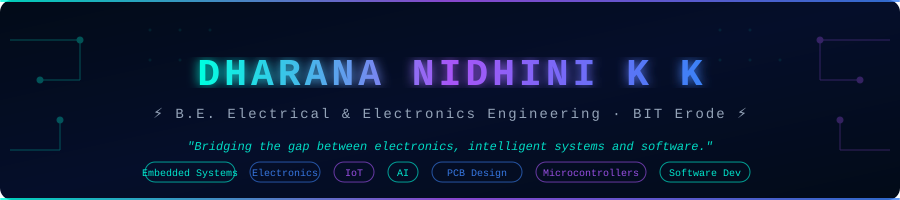
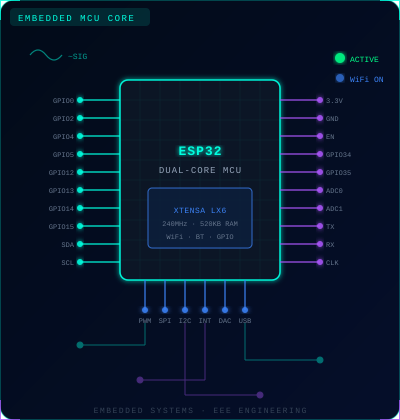
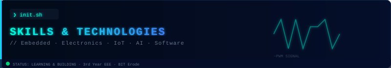
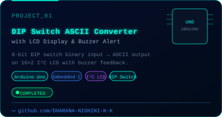
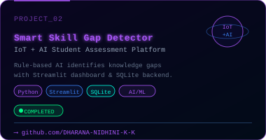

<!-- ═══════════════════════════════════════════════════════════════
     DHARANA NIDHINI K K — GitHub Profile README
     Premium Engineering Dashboard | Dark Futuristic Theme
     ═══════════════════════════════════════════════════════════════ -->

<!-- ╔══════════════════════════════════════════════════════╗
     ║               HEADER BANNER                         ║
     ╚══════════════════════════════════════════════════════╝ -->

<div align="center">



</div>

---

<!-- ╔══════════════════════════════════════════════════════╗
     ║          ANIMATED TYPING INTRODUCTION               ║
     ╚══════════════════════════════════════════════════════╝ -->

<div align="center">

[](https://git.io/typing-svg)

</div>

---

<!-- ╔══════════════════════════════════════════════════════╗
     ║      INTRODUCTION — CIRCUIT ART + BIO              ║
     ╚══════════════════════════════════════════════════════╝ -->

<table>
<tr>
<td width="45%" valign="top">

<!-- Custom SVG Circuit Illustration -->


</td>
<td width="55%" valign="top">

<br/>

```
╔════════════════════════════════════════╗
║  >> SYSTEM BOOT — PROFILE INIT ...    ║
║                                       ║
║  NAME   : DHARANA NIDHINI K K         ║
║  DEGREE : B.E. Electrical & EE        ║
║  INST.  : BIT Erode (3rd Year)        ║
║  MODE   : LEARNING + BUILDING         ║
║                                       ║
║  FOCUS  :                             ║
║    ⚡  Embedded Systems               ║
║    📡  Internet of Things             ║
║    🤖  Artificial Intelligence        ║
║    🔌  Electronics & Hardware         ║
║    💾  Software Development           ║
║    🔲  PCB Design                     ║
║    🧩  Microcontrollers               ║
║                                       ║
║  STATUS : [ ■■■■■■■■░░ ] GROWING      ║
╚════════════════════════════════════════╝
```

> *"Bridging the gap between electronics,*
> *intelligent systems and software."*

</td>
</tr>
</table>

---

<!-- ╔══════════════════════════════════════════════════════╗
     ║            GITHUB STATISTICS DASHBOARD             ║
     ╚══════════════════════════════════════════════════════╝ -->

<div align="center">

## ⚡ &nbsp;`{ GITHUB STATS DASHBOARD }`

<br/>


&nbsp;&nbsp;


<br/><br/>


</div>

---

<!-- ╔══════════════════════════════════════════════════════╗
     ║            TECHNICAL SKILLS DASHBOARD              ║
     ╚══════════════════════════════════════════════════════╝ -->

<div align="center">



</div>

<br/>

<!-- A. PROGRAMMING LANGUAGES -->

<details open>
<summary><b>⬡ &nbsp;A. Programming Languages</b></summary>
<br/>

<div align="center">

[](https://en.wikipedia.org/wiki/C_(programming_language))
[](https://isocpp.org/)
[](https://www.java.com/)
[](https://www.python.org/)

</div>
</details>

<br/>

<!-- B. EMBEDDED SYSTEMS & HARDWARE -->

<details open>
<summary><b>⬡ &nbsp;B. Embedded Systems &amp; Hardware</b></summary>
<br/>

<div align="center">

[](https://www.arduino.cc/)
[](https://www.espressif.com/)
[](https://en.wikipedia.org/wiki/Embedded_C)
[](https://en.wikipedia.org/wiki/Microcontroller)
[](#)
[](#)
[](#)
[](#)

</div>
</details>

<br/>

<!-- C. ELECTRONICS & PCB DESIGN -->

<details open>
<summary><b>⬡ &nbsp;C. Electronics &amp; PCB Design</b></summary>
<br/>

<div align="center">

[](https://en.wikipedia.org/wiki/Printed_circuit_board)
[](https://www.altium.com/)
[](#)
[](#)
[](#)

</div>
</details>

<br/>

<!-- D. SOFTWARE & DEVELOPMENT -->

<details open>
<summary><b>⬡ &nbsp;D. Software &amp; Development</b></summary>
<br/>

<div align="center">

[](https://git-scm.com/)
[](https://github.com/)
[](https://streamlit.io/)
[](https://en.wikipedia.org/wiki/SQL)
[](#)

</div>
</details>

<br/>

> **Note:** These reflect technologies I have explored and used in projects. I am a 3rd-year student — continuously learning and growing. No fake proficiency levels.

---

<!-- ╔══════════════════════════════════════════════════════╗
     ║           FEATURED PROJECTS SHOWCASE               ║
     ╚══════════════════════════════════════════════════════╝ -->

<div align="center">


</div>

<br/>

<!-- PROJECT 1 -->

<table>
<tr>
<td width="50%" valign="top">



</td>
<td width="50%" valign="top">

<br/>

### 🔌 &nbsp;DIP Switch ASCII Converter

An **Arduino-based digital system** that accepts 8-bit binary input via a DIP switch and converts it into ASCII characters displayed on a **16×2 I²C LCD** with buzzer feedback.

**What it does:**
- Reads 8-bit DIP switch binary input
- Converts binary code → ASCII character
- Displays output on 16×2 I²C LCD
- Triggers buzzer on valid character detected

**Tech Stack:**

`Arduino Uno` &nbsp; `Embedded C/C++` &nbsp; `I²C Protocol`
`16x2 LCD` &nbsp; `DIP Switch` &nbsp; `Buzzer` &nbsp; `Digital Electronics`

**Status:** &nbsp; 

🔗 **[View Repository →](https://github.com/DHARANA-NIDHINI-K-K)**

</td>
</tr>
</table>

<br/>

<!-- PROJECT 2 -->

<table>
<tr>
<td width="50%" valign="top">

<br/>

### 🤖 &nbsp;IoT + AI Smart Skill Gap Detector

A **student skill assessment platform** that identifies knowledge gaps using rule-based AI evaluation and provides a structured learning dashboard with personalised recommendations.

**What it does:**
- Assesses student skills across domains
- Detects knowledge gaps via rule-based logic
- Displays personalised assessment dashboard
- Stores results with SQLite for analysis

**Tech Stack:**

`Python` &nbsp; `Streamlit` &nbsp; `SQLite` &nbsp; `AI/ML Fundamentals`
`Data Analysis` &nbsp; `Rule-Based Logic`

**Status:** &nbsp; 

🔗 **[View Repository →](https://github.com/DHARANA-NIDHINI-K-K)**

</td>
<td width="50%" valign="top">



</td>
</tr>
</table>

<br/>

> 💡 *More projects available on my [GitHub repositories page →](https://github.com/DHARANA-NIDHINI-K-K?tab=repositories)*

---

<!-- ╔══════════════════════════════════════════════════════╗
     ║          GITHUB CONTRIBUTION ACTIVITY              ║
     ╚══════════════════════════════════════════════════════╝ -->

<div align="center">

## 📊 &nbsp;`{ CONTRIBUTION ACTIVITY }`

<br/>

[](https://github.com/DHARANA-NIDHINI-K-K)

</div>

---

<!-- ╔══════════════════════════════════════════════════════╗
     ║            CURRENTLY EXPLORING                     ║
     ╚══════════════════════════════════════════════════════╝ -->

<div align="center">

## 🛰️ &nbsp;`{ CURRENTLY EXPLORING }`

*Continuous learning — always expanding the horizon*

<br/>

</div>

<table align="center">
<tr>
<td align="center" width="140">
<br/>
⚙️
<br/>
<b>Embedded Systems</b>
<br/>
<sub>Development</sub>
<br/><br/>
</td>
<td align="center" width="140">
<br/>
☕
<br/>
<b>Advanced Java</b>
<br/>
<sub>OOP & DSA</sub>
<br/><br/>
</td>
<td align="center" width="140">
<br/>
🌐
<br/>
<b>IoT + AI</b>
<br/>
<sub>Integration</sub>
<br/><br/>
</td>
<td align="center" width="140">
<br/>
🔲
<br/>
<b>PCB Design</b>
<br/>
<sub>Altium Designer</sub>
<br/><br/>
</td>
<td align="center" width="140">
<br/>
🧮
<br/>
<b>DSA</b>
<br/>
<sub>Data Structures</sub>
<br/><br/>
</td>
<td align="center" width="140">
<br/>
🔗
<br/>
<b>HW-SW</b>
<br/>
<sub>Integration</sub>
<br/><br/>
</td>
</tr>
</table>

<br/>

<div align="center">

[](https://github.com/DHARANA-NIDHINI-K-K)
[](https://github.com/DHARANA-NIDHINI-K-K)
[](https://github.com/DHARANA-NIDHINI-K-K)
[](https://github.com/DHARANA-NIDHINI-K-K)

</div>

---

<!-- ╔══════════════════════════════════════════════════════╗
     ║           ENGINEERING INTERESTS                    ║
     ╚══════════════════════════════════════════════════════╝ -->

<div align="center">

## 🔬 &nbsp;`{ ENGINEERING INTERESTS }`

</div>

<br/>

```
  ┌─────────────────────────────────────────────────────────────────────┐
  │                                                                     │
  │   ⚡ HARDWARE         →→→→→→→→→→→→→→       SOFTWARE 💻             │
  │                                                                     │
  │   [ MCU / ESP32 ]  ══════════╗                                      │
  │   [ Arduino Uno ]  ══════════╬══► [ Embedded Firmware ]             │
  │   [ PCB Design  ]  ══════════╝         │                            │
  │                                        ▼                            │
  │                              [ Sensor Data & Logic ]                │
  │                                        │                            │
  │   [ IoT Sensors ] ═══════════╗         ▼                            │
  │   [ Actuators   ] ═══════════╬══► [ Cloud / Edge AI ]               │
  │   [ Protocols   ] ═══════════╝         │                            │
  │      I²C · SPI · UART                  ▼                            │
  │                              [ Intelligent Systems ]                │
  │                                        │                            │
  │                                        ▼                            │
  │                              [ Practical Engineering ]              │
  │                                   SOLUTIONS  ✓                      │
  │                                                                     │
  └─────────────────────────────────────────────────────────────────────┘
```

<br/>

<div align="center">

| 🔌 &nbsp;Hardware Meets Software | 🤖 &nbsp;Intelligent Embedded Systems | 📡 &nbsp;Connected IoT Devices |
|:---:|:---:|:---:|
| *Bridging physical electronics with firmware and software logic* | *Embedding AI decisions at the hardware level* | *Real-world sensors + cloud intelligence* |

| 🧠 &nbsp;AI-Powered Engineering | 📐 &nbsp;Electronic System Design |
|:---:|:---:|
| *Applying ML fundamentals to engineering problems* | *From schematic to working circuit* |

</div>

---

<!-- ╔══════════════════════════════════════════════════════╗
     ║              CONNECT WITH ME                        ║
     ╚══════════════════════════════════════════════════════╝ -->

<div align="center">

## 🌐 &nbsp;`{ CONNECT WITH ME }`

*Let's connect, collaborate and build something extraordinary.*

<br/>

[](https://github.com/DHARANA-NIDHINI-K-K)
&nbsp;
[](https://www.linkedin.com/in/dharana-nidhini-k-k)

<br/>

> 📌 **LinkedIn** is linked directly from my GitHub profile.
> Please verify the URL via my [GitHub profile page](https://github.com/DHARANA-NIDHINI-K-K).

</div>

---

<!-- ╔══════════════════════════════════════════════════════╗
     ║                  FOOTER                            ║
     ╚══════════════════════════════════════════════════════╝ -->

<div align="center">

```
╔════════════════════════════════════════════════════════════════╗
║   DHARANA NIDHINI K K  ·  B.E. Electrical & Electronics Engg  ║
║   Bannari Amman Institute of Technology  ·  Erode              ║
║   ─────────────────────────────────────────────────────────    ║
║   "Bridging the gap between electronics,                       ║
║    intelligent systems and software."                          ║
╚════════════════════════════════════════════════════════════════╝
```

<br/>


<br/>

*⚡ Built with passion for engineering · Last updated 2026*

</div>

<!-- ═══════════════════════════════════════════════════════════
     END OF README
     ═══════════════════════════════════════════════════════════ -->

