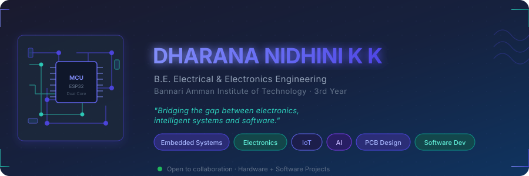
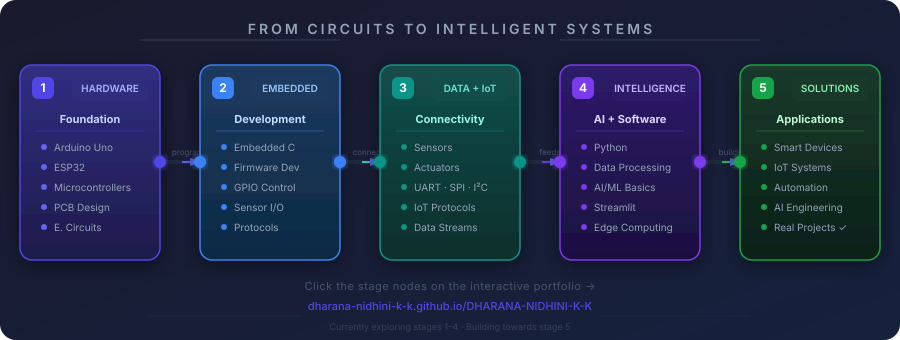
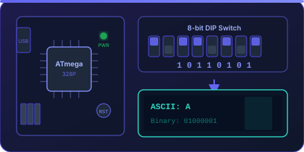
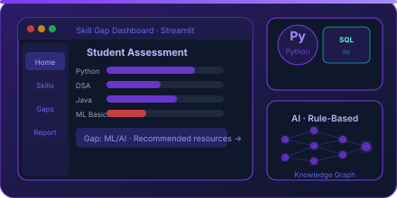

<!-- ═══════════════════════════════════════════════════════════════════════
     DHARANA NIDHINI K K — GitHub Profile README
     Material Design 3 · Engineering Portfolio
     ═══════════════════════════════════════════════════════════════════════ -->

<!-- ━━━━━━━━━━━━━━━━━━━━━━━━━━━━━━━━━━━━━━━━━━━━━━━━━━━━━━
     HERO BANNER
     ━━━━━━━━━━━━━━━━━━━━━━━━━━━━━━━━━━━━━━━━━━━━━━━━━━━━━━ -->

 

---

<!-- ━━━━━━━━━━━━━━━━━━━━━━━━━━━━━━━━━━━━━━━━━━━━━━━━━━━━━━
     PERSONAL INTRODUCTION
     ━━━━━━━━━━━━━━━━━━━━━━━━━━━━━━━━━━━━━━━━━━━━━━━━━━━━━━ -->

<table>
<tr>
<td width="44%" valign="middle">

</td>
<td width="56%" valign="middle">

 

**`DHARANA NIDHINI K K`**

B.E. Electrical & Electronics Engineering · 3rd Year
Bannari Amman Institute of Technology, Erode

 

An EEE student passionate about combining **electronics**, **embedded hardware**, **intelligent systems** and **software** to develop practical engineering solutions.

 

> *"Bridging the gap between electronics, intelligent systems and software."*

 

**Interests &nbsp;·&nbsp;** Embedded Systems &nbsp;|&nbsp; Electronics &nbsp;|&nbsp; IoT &nbsp;|&nbsp; AI &nbsp;|&nbsp; PCB Design &nbsp;|&nbsp; Microcontrollers

 

&nbsp;

&nbsp;

 

</td>
</tr>
</table>

---

<!-- ━━━━━━━━━━━━━━━━━━━━━━━━━━━━━━━━━━━━━━━━━━━━━━━━━━━━━━
     ENGINEERING JOURNEY
     ━━━━━━━━━━━━━━━━━━━━━━━━━━━━━━━━━━━━━━━━━━━━━━━━━━━━━━ -->

## From Circuits to Intelligent Systems

An evolving journey across hardware, firmware, data, intelligence and practical applications

 

 

> 🌐 **Explore the full interactive version on my portfolio site →** &nbsp; [**dharana-nidhini-k-k.github.io/DHARANA-NIDHINI-K-K**](https://dharana-nidhini-k-k.github.io/DHARANA-NIDHINI-K-K)

---

<!-- ━━━━━━━━━━━━━━━━━━━━━━━━━━━━━━━━━━━━━━━━━━━━━━━━━━━━━━
     TECHNICAL SKILLS
     ━━━━━━━━━━━━━━━━━━━━━━━━━━━━━━━━━━━━━━━━━━━━━━━━━━━━━━ -->

## Technical Skills

Technologies I have explored and used in projects · No invented proficiency levels

 

<b>&nbsp;&nbsp;💻 &nbsp;Programming Languages</b>

 

)&nbsp;
&nbsp;
&nbsp;

 

<b>&nbsp;&nbsp;⚙️ &nbsp;Embedded Systems &amp; Hardware</b>

 

&nbsp;
&nbsp;
&nbsp;
&nbsp;
&nbsp;
&nbsp;
&nbsp;

 

<b>&nbsp;&nbsp;🔲 &nbsp;Electronics &amp; PCB Design</b>

 

&nbsp;
&nbsp;
&nbsp;
&nbsp;

 

<b>&nbsp;&nbsp;🌐 &nbsp;IoT &amp; Connectivity</b>

 

&nbsp;
&nbsp;
&nbsp;
&nbsp;

 

<b>&nbsp;&nbsp;🛠️ &nbsp;Software &amp; Development</b>

 

&nbsp;
&nbsp;
&nbsp;
&nbsp;

 

🔍 Explore the interactive skills explorer on my <a href="https://dharana-nidhini-k-k.github.io/DHARANA-NIDHINI-K-K#skills"><b>portfolio site</b></a>

---

<!-- ━━━━━━━━━━━━━━━━━━━━━━━━━━━━━━━━━━━━━━━━━━━━━━━━━━━━━━
     FEATURED PROJECTS
     ━━━━━━━━━━━━━━━━━━━━━━━━━━━━━━━━━━━━━━━━━━━━━━━━━━━━━━ -->

## Featured Projects

Real engineering solutions · Hardware to software · Genuine project work only

 

<!-- PROJECT 1 ─────────────────────────────────────── -->

<table>
<tr>
<td width="48%" valign="top">

</td>
<td width="52%" valign="top">

 

### DIP Switch ASCII Converter

**with 16×2 LCD Display & Buzzer Alert**

An Arduino-based digital system that accepts 8-bit binary input via a DIP switch and converts it to ASCII characters displayed on a 16×2 I²C LCD, with buzzer feedback.

**What it does:**
- Reads 8-bit DIP switch binary input
- Converts binary → ASCII character in real time
- Displays output on 16×2 I²C LCD
- Triggers buzzer on valid character detection

**Tech Stack:**

**Status:** &nbsp; 

🔗 &nbsp;[**View Repository →**](https://github.com/DHARANA-NIDHINI-K-K)

 

</td>
</tr>
</table>

 

<!-- PROJECT 2 ─────────────────────────────────────── -->

<table>
<tr>
<td width="52%" valign="top">

 

### IoT + AI Smart Skill Gap Detector

**Student Knowledge Assessment Platform**

A skill assessment platform that identifies student knowledge gaps using rule-based AI evaluation, providing a structured learning dashboard with personalised insights and recommendations.

**What it does:**
- Assesses student skills across multiple domains
- Detects knowledge gaps via rule-based AI logic
- Displays personalised assessment dashboard
- Stores results in SQLite for persistent analysis

**Tech Stack:**

**Status:** &nbsp; 

🔗 &nbsp;[**View Repository →**](https://github.com/DHARANA-NIDHINI-K-K)

 

</td>
<td width="48%" valign="top">

</td>
</tr>
</table>

 

More projects on my <a href="https://github.com/DHARANA-NIDHINI-K-K?tab=repositories"><b>repositories page</b></a> &nbsp;·&nbsp; Interactive cards on the <a href="https://dharana-nidhini-k-k.github.io/DHARANA-NIDHINI-K-K#projects"><b>portfolio site</b></a>

---

<!-- ━━━━━━━━━━━━━━━━━━━━━━━━━━━━━━━━━━━━━━━━━━━━━━━━━━━━━━
     GITHUB STATISTICS
     ━━━━━━━━━━━━━━━━━━━━━━━━━━━━━━━━━━━━━━━━━━━━━━━━━━━━━━ -->

## GitHub Activity

 

&nbsp;&nbsp;

  

  

---

<!-- ━━━━━━━━━━━━━━━━━━━━━━━━━━━━━━━━━━━━━━━━━━━━━━━━━━━━━━
     CURRENTLY EXPLORING
     ━━━━━━━━━━━━━━━━━━━━━━━━━━━━━━━━━━━━━━━━━━━━━━━━━━━━━━ -->

## Currently Exploring

Continuous learning — always expanding the horizon, one concept at a time

 

| &nbsp; | Topic | Focus |
|:---:|:---|:---|
| ⚙️ | **Embedded Systems Development** | Advanced MCU programming and RTOS concepts |
| ☕ | **Advanced Java** | OOP principles · Collections · Data Structures & Algorithms |
| 📡 | **IoT + AI Integration** | Combining sensor networks with intelligent decision-making |
| 🔲 | **PCB Design** | Altium Designer · Schematic capture · Layout techniques |
| 🧮 | **Data Structures & Algorithms** | Algorithmic problem-solving and computational thinking |
| 🔗 | **Hardware–Software Integration** | Bridging hardware control with software intelligence |

 

&nbsp;
&nbsp;
&nbsp;
&nbsp;
&nbsp;

---

<!-- ━━━━━━━━━━━━━━━━━━━━━━━━━━━━━━━━━━━━━━━━━━━━━━━━━━━━━━
     CONNECT WITH ME
     ━━━━━━━━━━━━━━━━━━━━━━━━━━━━━━━━━━━━━━━━━━━━━━━━━━━━━━ -->

## Connect & Collaborate

*Always open to discussing engineering, embedded systems, IoT, AI, or just connecting with fellow builders.*

 

&nbsp;&nbsp;

&nbsp;&nbsp;

---

<!-- ━━━━━━━━━━━━━━━━━━━━━━━━━━━━━━━━━━━━━━━━━━━━━━━━━━━━━━
     FOOTER
     ━━━━━━━━━━━━━━━━━━━━━━━━━━━━━━━━━━━━━━━━━━━━━━━━━━━━━━ -->

 

**Dharana Nidhini K K** &nbsp;·&nbsp; B.E. Electrical & Electronics Engineering &nbsp;·&nbsp; BIT Erode &nbsp;·&nbsp; 3rd Year

Embedded Systems · Electronics · IoT · AI · PCB Design · Software Development

 

